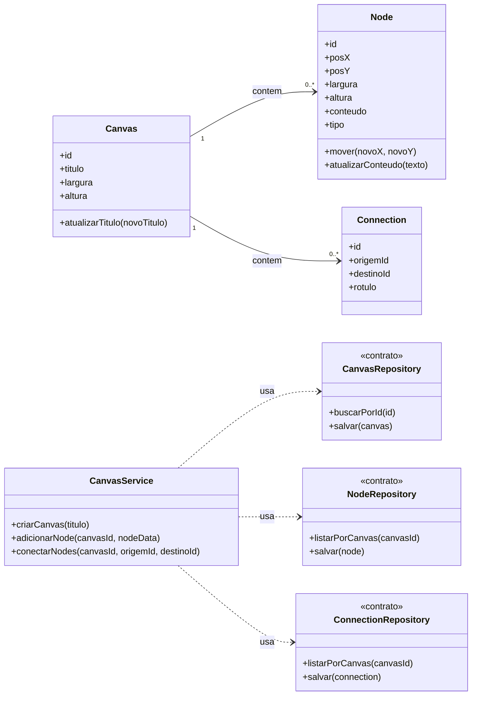

# Modelagem — Projeto 1

**Aluno(a):** Lucas de Medeiros Trindade
**Domínio:** Sistema de criação de mapas mentais e fluxogramas (Canvas Interativo)

## 1. O domínio

A aplicação permite que usuários criem espaços visuais (canvas) compostos por nós (formas, textos ou cartões) e conexões direcionadas (linhas ou setas) entre eles para estruturar ideias e fluxos de trabalho.

## 2. Entidades

| Entidade   | Atributos                                       | Relacionamentos                             |
| ---------- | ----------------------------------------------- | ------------------------------------------- |
| Canvas     | id, titulo, largura, altura                     | possui vários nós e conexões                |
| Node       | id, posX, posY, largura, altura, conteudo, tipo | pertence a um canvas; participa de conexões |
| Connection | id, origemId, destinoId, rotulo                 | pertence a um canvas; conecta dois nós      |

## 3. Diagrama de classes

## 4. Responsabilidades

| Classe                                                 | Papel            | Único motivo para mudar                                                     |
| ------------------------------------------------------ | ---------------- | --------------------------------------------------------------------------- |
| Canvas, Node, Connection                               | entidades        | regras inerentes aos elementos visuais (ex: mover um nó, alterar dimensões) |
| CanvasService                                          | regra de negócio | a lógica de orquestração (criar o mapa, conectar nós, gerenciar o fluxo)    |
| CanvasRepository, NodeRepository, ConnectionRepository | acesso aos dados | a forma de persistência (memória na S3, banco de dados posteriormente)      |

## 5. Onde apliquei SRP e DIP

- **SRP:** nenhuma entidade manipula persistência ou faz operações de banco de dados por conta própria. O salvamento e busca são exclusivos dos _repositories_. A regra de negócio central fica restrita ao `CanvasService`.
- **DIP:** o `CanvasService` depende puramente dos contratos (`<<contrato>>`) dos _repositories_, mantendo-se desacoplado da tecnologia de armazenamento final.

## 6. Fora do escopo (YAGNI)

Colaboração em tempo real via WebSockets, histórico detalhado de desfazer/refazer (_undo/redo_), exportação para PNG/PDF e autenticação de usuários não entram no escopo do Projeto 1.
